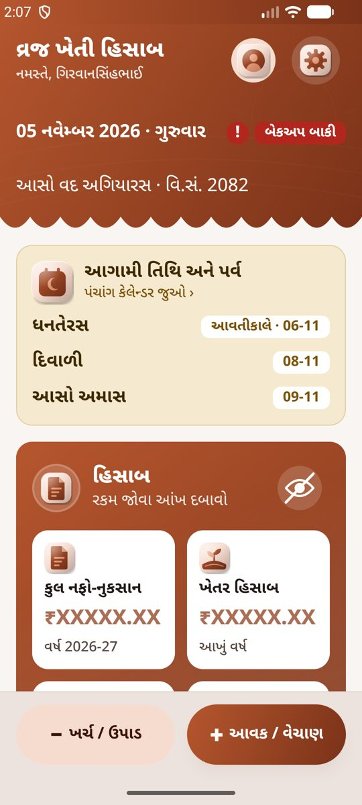
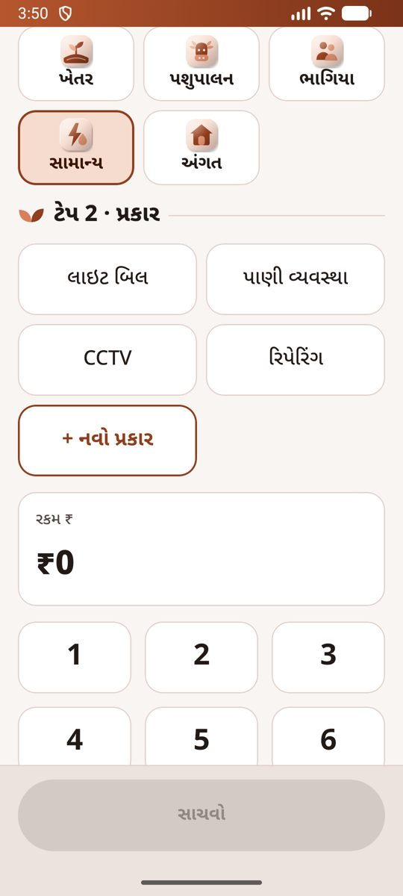
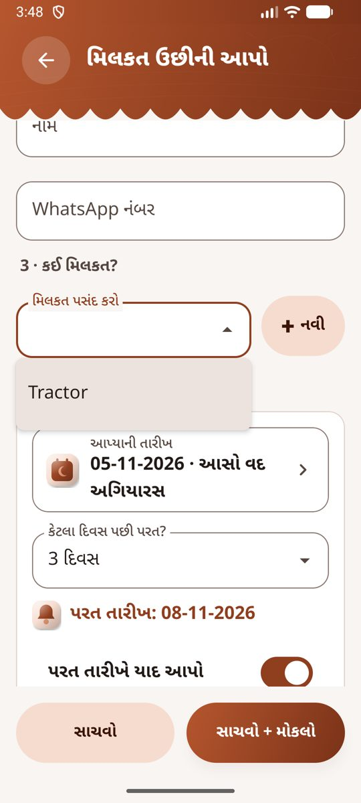
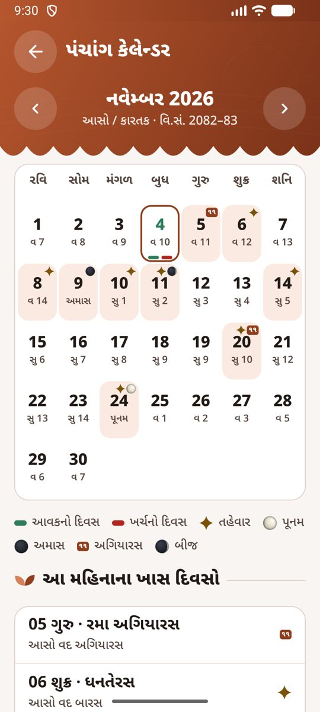
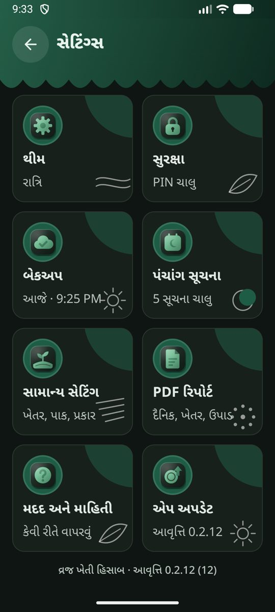
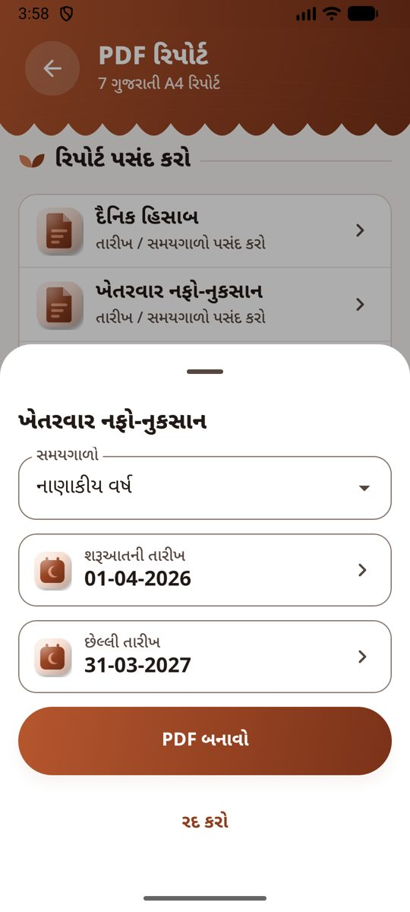
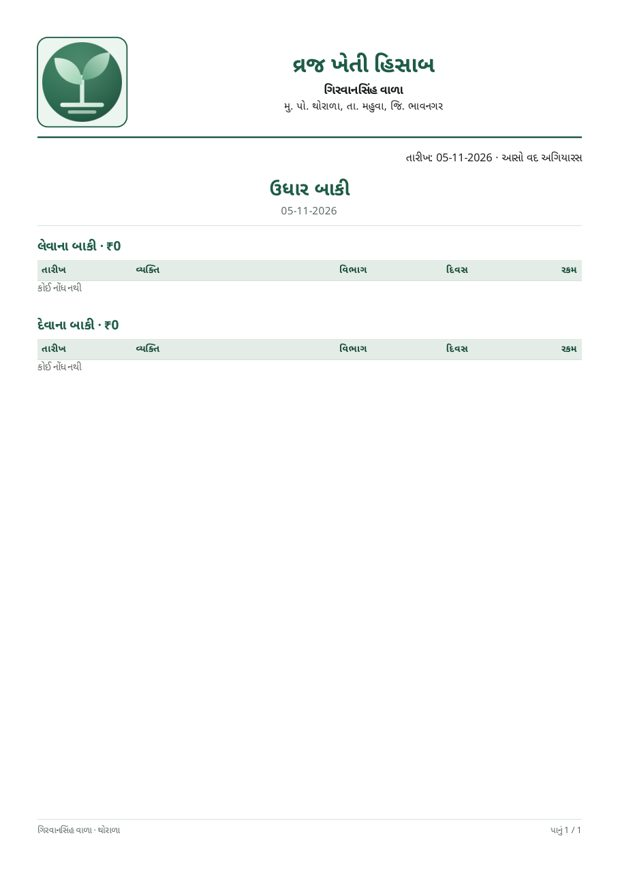

# Vraj Kheti Hisab · વ્રજ ખેતી હિસાબ

An offline-first Gujarati Android app for running a family farm: income and expenses per farm and section, profit and loss, ભાગિયા (farm-manager) advances, animal husbandry with a milk register, credit (ઉધાર), assets lent to neighbours, a shopping list, reminders and a Gujarati Panchang calendar with festival alerts.

Built for the Vala family farm in Thorala (Ta. Mahuva, Dist. Bhavnagar). All data stays on the phone; backups go to the owner's own Google Drive, WhatsApp or e-mail.

**Download the latest APK:** https://github.com/solerunner26/Vrajfarm/releases/latest

| Home | Entry | Lend an asset | Panchang calendar |
|---|---|---|---|
|  |  |  |  |

| Settings (Night theme) | Report options | PDF letterhead |
|---|---|---|
|  |  |  |

## Features

**Accounts**
- Five sections: ખેતર (8 farms), પશુપાલન (animals), ભાગિયા ઉપાડ (farm-manager advances), સામાન્ય ખર્ચ (light, water, CCTV), અંગત / ઘર (personal, never counted in the business P&L).
- 3-tap entry with an APMC મણ calculator (`TotalMann = Mann + ExtraKg / 20`), bill photo, typed or spoken note, and whole-sentence voice entry ("ખાતર બે હજાર ખેતર ત્રણ ઉધાર રમેશભાઈ").
- ઉધાર (credit): "હજી આપવાના / હજી લેવાના" with the person's name; settle from Home.
- Edit or delete any entry, with undo.
- Farm P&L by season, profit per વીઘા scorecard, a farm can be run by one or both ભાગિયા.
- દૂધ રજીસ્ટર: morning/evening litres, fat and rate per animal; compares what the dairy should pay with what it paid.

**Home and privacy**
- Tiles for Hisab, ભાગિયા ઉપાડ, અંગત, સામાન્ય ખર્ચ, ખરીદી, મિલકત and the milk register.
- All amounts on Home are hidden as `₹XXXXX.XX` until the eye button is tapped (a setting can show them always).
- PIN and fingerprint lock; screenshots blocked in release builds.

**Panchang**
- Gujarati tithi, Vikram Samvat, sunrise/sunset, festivals, and realistic 3D moon phases.
- Calendar days are coloured green (income) or red (expense); tap a day to see its entries.
- Evening-before alerts for બીજ, અગિયારસ, પૂનમ, અમાસ and festivals, with editable guidance framed "માન્યતા પ્રમાણે".

**Assets, shopping, reminders**
- Asset register (add/edit/delete), lend with borrower photo and return date, weekly reminders with "પરત આવી ગયું / 1 અઠવાડિયા / 1 મહિના પછી".
- Pre-filled WhatsApp messages for ભાગિયા advances and overdue assets (never sent automatically).
- Shopping list that turns tools into assets; reminders with photos; home-screen widgets.

**Reports and backup**
- 7 Gujarati A4 PDF reports with a letterhead (logo, owner, address, phone, date, title).
- One JSON backup of everything (14 tables + photos) to Google Drive (automatic every night), WhatsApp or Gmail (one tap); restore on a new phone from any of them. Red alert and 9:30 PM reminder when no backup was taken today.

**App**
- 5 themes (લીલો, માટી, આકાશ, કેસર, રાત્રિ), all in one two-tone hue; Gujarati keyboard hinted in every field.
- Updates itself from GitHub releases: the app shows "નવું અપડેટ આવ્યું છે" with one button.

## Documentation

| For | Read |
|---|---|
| The owner / users (Gujarati) | [docs/USER_GUIDE.md](docs/USER_GUIDE.md) |
| Developers | [docs/DEVELOPER.md](docs/DEVELOPER.md) |
| What changed in each version | [CHANGELOG.md](CHANGELOG.md) |
| AI agents continuing the work | [AGENTS.md](AGENTS.md), then [HANDOVER.md](HANDOVER.md) |
| Feature specs | [handover/](handover/00_README.md) |
| Design system | [handover/01_Design_System.md](handover/01_Design_System.md), [design/](design/canvas/README.md) |

## Requirements

Android 10 (API 29) or newer. Tested on Android 16 (emulator) and targeted at the Samsung Galaxy S22 and Google Pixel.

---

Owner: Girwansinh Vala, Thorala, Ta. Mahuva, Dist. Bhavnagar · Design and development: Jaldip Vala
